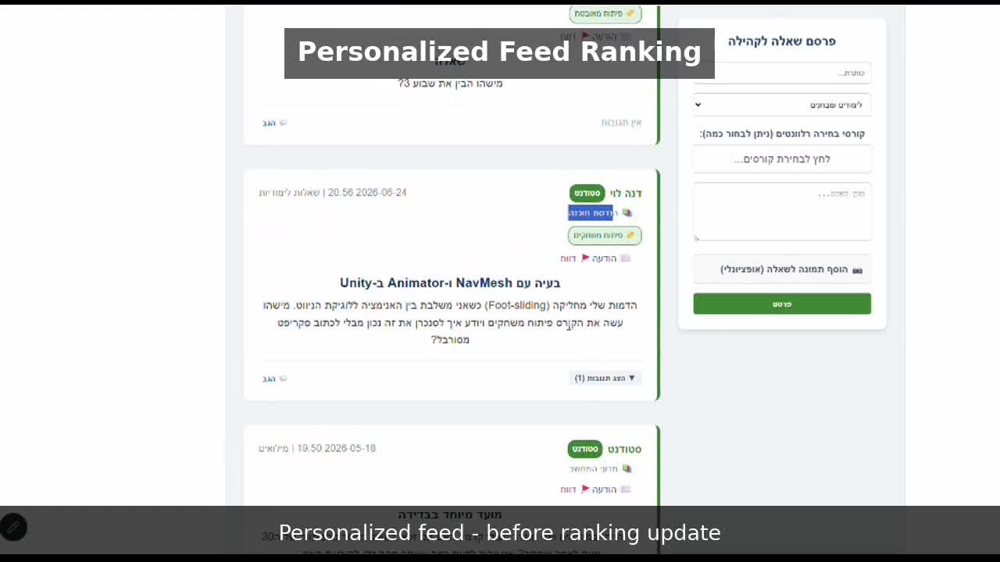

# Just A.S.K — Afeka Shared Knowledge 🎓

Just A.S.K is a full-stack student community platform that combines traditional community features with AI-powered tools for academic information and student collaboration.

The platform includes a Q&A forum, personalized content ranking, private messaging, study-material sharing, an industry board, a second-hand marketplace, automatic AI tagging, and a RAG assistant that answers questions using official college regulations.

## 🎥 Demo

[▶ Watch the project demo](docs/assets/Just_ASK_Portfolio_Demo.mp4)



▶ **Click the preview above to watch the full demo**


The demo showcases:

- Personalized feed ranking
- RAG-based answers from uploaded regulation documents
- AI-powered automatic question tagging
- n8n workflow orchestration

## ✨ Key Features

- **Student Q&A Forum** — users can publish questions, reply, and interact with the student community.
- **Personalized Feed** — content is ranked using relevance signals such as academic track and course-related tags.
- **AI Auto-Tagging** — new questions are automatically analyzed and tagged using an n8n + Gemini workflow.
- **RAG Assistant** — answers academic questions using information retrieved from uploaded official regulation PDFs.
- **Private Messaging** — direct communication between users.
- **Industry Board** — graduates can publish job opportunities and industry-related content.
- **Study Material Sharing** — students can upload and share academic resources.
- **Second-Hand Marketplace** — users can publish items for sale.
- **Admin Panel** — moderation, reports, user management, and knowledge-base administration.
- **Authentication & Authorization** — JWT-based authentication with server-side role and ownership checks.

## 🛠 Tech Stack

| Area | Technology |
| --- | --- |
| Frontend | React, Vite, JavaScript |
| Backend | Python, FastAPI |
| Database | MongoDB |
| AI / LLM | Google Gemini |
| RAG | Embeddings + Vector Store |
| Automation | n8n |
| Authentication | JWT + Bcrypt |
| API Communication | REST, Axios, httpx |

## 🏗 Architecture

```text
React Frontend
      │
      │ REST API
      ▼
FastAPI Backend
      │
      ├──────────────► MongoDB
      │
      ▼
     n8n
      │
      ├──────────────► Gemini
      └──────────────► RAG / Vector Store
```

The React frontend communicates with the FastAPI backend through REST APIs.

FastAPI handles authentication, authorization, application logic, MongoDB access, and communication with the automation layer.

n8n orchestrates the AI workflows used for automatic question tagging and RAG-based question answering.

### RAG Flow

```text
Regulation PDF
      ↓
Document Chunks
      ↓
Embeddings
      ↓
Vector Store

User Question
      ↓
Question Embedding
      ↓
Relevant Chunks Retrieved
      ↓
Gemini + Retrieved Context
      ↓
Grounded Answer
```

Uploaded regulation documents are split into chunks and converted into embeddings.

When a user asks a question, relevant document chunks are retrieved from the vector store and supplied to Gemini as context before the response is generated.

## 🔐 Security Highlights

The backend includes several application-security measures:

- JWT-based authentication for protected endpoints.
- Server-side authorization and role checks.
- Password hashing with Bcrypt.
- User identity derived from the authenticated token rather than trusted directly from client input.
- Ownership validation for user-generated resources.
- Admin role assignment is restricted from normal registration.
- Knowledge-base uploads require server-side Admin authorization.
- File uploads use an allowed-extension list.
- Regex-based search input is escaped before being used in database queries.
- CORS is restricted to the frontend origin.
- Sensitive configuration is loaded from environment variables rather than committed to the repository.

## 🚀 Production Considerations

The project was designed primarily as an academic capstone and local development environment.

For a production deployment, the main improvements would include:

- Replacing the in-memory vector store with persistent vector storage.
- Strengthening authentication and network isolation between internal services.
- Expanding automated test coverage.
- Adding stronger file-content validation.
- Adding centralized logging, monitoring, and deployment infrastructure.

## ▶️ Running the Project

### Prerequisites

Install:

- Python 3.10+
- Node.js 18+
- MongoDB Community Server
- n8n
- Google Gemini API credentials

### 1. Backend

From the project root:

```bash
pip install -r requirements.txt
```

Copy:

```text
.env.example
```

to:

```text
.env
```

and configure the required environment variables.

Then start the backend:

```bash
python main.py
```

The API runs at:

```text
http://127.0.0.1:8000
```

### 2. Frontend

```bash
cd frontend
npm install
npm run dev
```

The frontend runs at:

```text
http://localhost:5173
```

### 3. MongoDB

Make sure MongoDB is running locally on:

```text
mongodb://localhost:27017
```

Database:

```text
ask_database
```

### 4. n8n

Start n8n:

```bash
n8n
```

Then open:

```text
http://localhost:5678
```

Import the workflows from:

```text
n8n_workflows/
```

Included workflows:

```text
PDF_RAG_Chatbot_with_Gemini.json
Auto_Tag_Questions_NLP.json
```

Configure the required Gemini and MongoDB credentials, then activate the workflows.

## 🌱 Demo Data

Once the backend and database are running:

```bash
python seed.py
```

This creates demo users, forum questions, replies, and an industry post.

Example account:

```text
dana@student.afeka.ac.il
```

Demo password:

```text
password123
```

These credentials are intended for local demo data only.

## 📚 Loading Documents into the RAG Assistant

1. Log in with an Admin account.
2. Open the **Knowledge Base** section.
3. Upload a regulation PDF.
4. The backend authorizes the request and sends the document to the automation workflow.
5. The document is processed into chunks and embeddings.
6. Users can then ask the **A.S.K Agent** questions based on the uploaded regulations.

The current vector store is in-memory, so uploaded knowledge must be loaded again after restarting n8n.

## 📁 Project Structure

```text
├── main.py
│   └── FastAPI backend and REST endpoints
│
├── seed.py
│   └── Demo-data seeding
│
├── requirements.txt
│   └── Python dependencies
│
├── .env.example
│   └── Environment-variable template
│
├── n8n_workflows/
│   ├── PDF_RAG_Chatbot_with_Gemini.json
│   └── Auto_Tag_Questions_NLP.json
│
├── frontend/
│   ├── package.json
│   └── src/
│       ├── pages/
│       ├── components/
│       └── utils/
│
├── docs/
│   └── assets/
│       └── Just_ASK_Portfolio_Demo.mp4
│
└── uploads/
    └── Runtime user uploads
```
